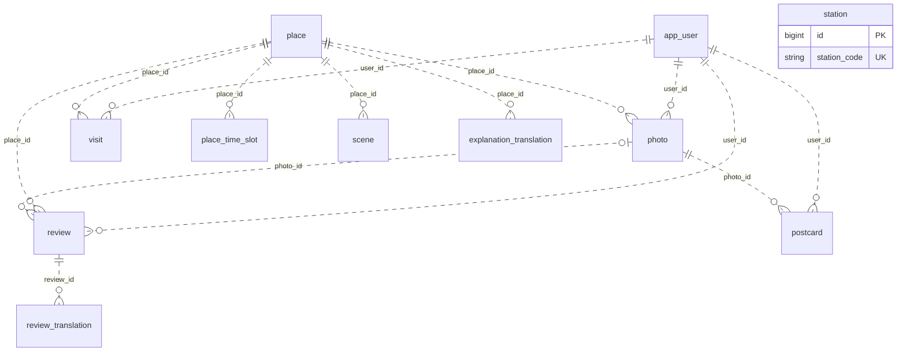

# DB 설계

**엔티티·테이블·컬럼의 기준 문서다. 엔티티를 만들거나 고치기 전에 반드시 읽는다.**

- 여기 없는 테이블·컬럼을 만들지 않는다. 필요하면 엔티티와 같은 PR에서 이 문서를 먼저 고친다.
- 제3정규형(3NF)을 지킨다. 어긋나는 컬럼을 넣으려면 이유를 이 문서에 적는다.
- DB는 MySQL 8.4, 테스트는 H2(MySQL 모드)다. 스키마는 JPA `ddl-auto: update`로 만든다.

## 테이블 한눈에 보기

| 테이블 | 엔티티 | 패키지 | 기능 | 상태 |
|---|---|---|---|---|
| `app_user` | `AppUser` | `domain/user` | F1 | 구현됨 |
| `place` | `Place` | `domain/place` | 공통 | 구현됨 |
| `place_time_slot` | `Place`의 컬렉션 | `domain/place` | F2 | 구현됨 |
| `station` | `Station` | `domain/place` | F2 | 구현됨 |
| `photo` | `Photo` | `domain/photo` | F4·F6·F7 | 구현됨 |
| `visit` | `Visit` | `domain/visit` | F5·F6·F2 | 구현 전 |
| `review` | `Review` | `domain/review` | F6·F3 | 구현됨 |
| `review_translation` | `ReviewTranslation` | `domain/review` | F6 | 구현됨 |
| `explanation_translation` | `ExplanationTranslation` | `domain/place` | F4 | 구현됨 |
| `scene` | `Scene` | `domain/scene` | F3 | 구현됨 |
| `postcard` | `Postcard` | `domain/postcard` | F7 | 구현 전 |

점선은 ID로만 참조하는 관계다. 외래 키는 만들지 않는다. `station`은 다른 테이블과 연결되지 않는다.



## 공통 규칙

### 꼭 지킬 것
1. **외래 키와 JPA 연관관계를 쓰지 않는다.** `@ManyToOne` 대신 `Long placeId`, `String userId`로 참조하고, 존재 여부는 서비스에서 확인한다. 같은 애그리거트 안의 `@ElementCollection`(`place_time_slot`)만 예외다.
2. **다른 도메인 데이터는 그 도메인의 service로 가져온다.** 다른 도메인의 repository나 엔티티를 JPQL에서 직접 쓰지 않는다.
3. **위치(lat/lng)를 어떤 테이블에도 저장하지 않는다.** `place`와 `station`의 좌표만 예외다.
4. **쉼표로 여러 값을 넣지 않는다.** 여러 값이면 테이블을 나눈다.
5. **다른 컬럼에서 계산되는 값을 저장하지 않는다.** 사용자에게서 알 수 있는 값(국적, 샘플 여부)을 복사하지 않는다.
6. **응답에 시각을 내보내지 않는다.** 방문·한걸음은 날짜까지만 내보낸다.

### 엔티티 작성법
- 모든 엔티티는 `BaseTimeEntity`를 상속한다. 아래 표에는 `created_at`, `updated_at`을 적지 않았지만 모두 있다.
- 이름은 자동 변환된다 (`placeId` → `place_id`). `@Table(name=...)`은 `app_user`처럼 엔티티 이름과 다를 때만 쓴다.
- **`user`를 테이블·컬럼 이름으로 쓰지 않는다.** H2에서 예약어라 테스트가 깨질 수 있다.
- 공개되는 ID(`app_user`, `photo`, `postcard`)는 서버가 만든 UUID 문자열이고, 나머지는 `IDENTITY`로 만든 `BIGINT`다.
- `@Lob String`은 MySQL에서 `LONGTEXT`가 된다. 긴 글에 쓴다.
- 유니크 제약과 인덱스는 `@Table(uniqueConstraints = ..., indexes = ...)`로 선언한다.

### enum 컬럼
`@Enumerated(EnumType.STRING)` + `@Column(nullable = false, length = 20)`으로 만든다. MySQL에서는 네이티브 `enum('A','B')` 컬럼이 되고, 상수를 추가하면 서버를 켤 때 자동으로 반영된다.

### 스키마를 바꾼 뒤
`ddl-auto: update`는 서버를 켤 때 새 테이블·컬럼을 만들고 enum 상수 추가도 반영한다. 컬럼은 지우지 않으므로 쓰지 않는 컬럼이 남지만, NULL을 허용하는 컬럼이면 동작에는 문제가 없다. 컬럼 이름을 바꾸면 새 컬럼이 생길 뿐 데이터는 옮겨지지 않는다. 다른 타입 변경은 저절로 된다고 가정하지 말고 `SHOW COLUMNS`로 확인한다. 예를 들어 이미 `varchar`인 컬럼은 enum으로 바뀌지 않는다 (값 저장과 조회는 그대로 된다).

스키마를 바꾸면 이 문서를 고치고 팀에 알린다. 남은 컬럼까지 지우고 싶을 때만 로컬 DB를 초기화한다. 저장된 데이터가 모두 사라지고, `place`·`station`은 키가 있으면 서버를 켤 때 다시 동기화된다.

```bash
docker compose down -v
```

## 테이블 정의

### `app_user` 익명 사용자
| 컬럼 | 타입 | NULL | 설명 |
|---|---|---|---|
| `id` | VARCHAR(36) PK | N | 서버가 만든 UUID. 프론트가 기기에 저장한다 |
| `nationality` | ENUM | N | `Nationality` |
| `language` | ENUM | N | `Language` |
| `sample` | BOOLEAN | N | 샘플 사용자면 true |

샘플 사용자도 여기에 행으로 넣는다. 샘플 방문·한걸음은 이 사용자의 `sample`로 구분한다.

### `place` 장소
| 컬럼 | 타입 | NULL | 출처 | 설명 |
|---|---|---|---|---|
| `id` | BIGINT PK | N | | |
| `content_id` | VARCHAR(20) UK | N | TourAPI | 동기화 키 |
| `content_type_id` | VARCHAR(10) | Y | TourAPI | 12 관광지, 14 문화시설, 38 쇼핑 |
| `name` | VARCHAR(255) | N | TourAPI | |
| `address` | VARCHAR(255) | Y | TourAPI | |
| `latitude`, `longitude` | DOUBLE | N | TourAPI | |
| `overview` | LONGTEXT | Y | TourAPI | 개요 |
| `image_url` | VARCHAR(500) | Y | TourAPI | |
| `tour_modified_time` | VARCHAR(14) | Y | TourAPI | 개요 재조회 판단용 |
| `indoor` | BIT(1) | Y | 보강 파일 | 없으면 문화시설만 true |
| `sensitive_history` | BIT(1) | N | 보강 파일 | 식민지 역사가 얽힌 장소 |
| `explanation` | LONGTEXT | Y | 보강 파일 | 팀이 쓴 해설 |
| `status` | ENUM | N | 규칙 | `ACTIVE`, `PENDING_REVIEW`, `EXCLUDED`, `INACTIVE` |

- 추천·후보에는 `ACTIVE`만 쓴다.
- 현장 해설 원문은 `Place.fieldExplanation()`을 쓴다.
- 사라진 장소는 지우지 않고 `INACTIVE`로 바꾼다. 방문과 한걸음이 참조하기 때문이다.

### `place_time_slot` 장소별 추천 시간대
| 컬럼 | 타입 | NULL | 설명 |
|---|---|---|---|
| `place_id` | BIGINT PK | N | |
| `time_slot` | ENUM PK | N | `MORNING`(06–11), `AFTERNOON`(11–17), `EVENING`(17–21) |

- `Place.getTimeSlots()`로 읽는다. 값은 `global/common/TimeSlot`이다.
- 장소 동기화 때 채워진다. TourAPI 키가 없거나 동기화를 끄면 새로 채워지지 않는다.
- `PlaceSyncService`가 트랜잭션 없이 돌기 때문에 `EAGER`로 읽는다. 트랜잭션 안에서만 읽는 컬렉션을 새로 만들면 기본값(LAZY)을 쓴다.

### `station` 지하철역
| 컬럼 | 타입 | NULL | 설명 |
|---|---|---|---|
| `id` | BIGINT PK | N | |
| `station_code` | VARCHAR(10) UK | N | T Data `outStnNum` |
| `name` | VARCHAR(50) | N | |
| `line` | VARCHAR(30) | N | |
| `latitude`, `longitude` | DOUBLE | N | |

환승역은 호선마다 한 행이다.

### `photo` 사진
| 컬럼 | 타입 | NULL | 설명 |
|---|---|---|---|
| `id` | VARCHAR(36) PK | N | UUID. 번호 추측을 막는다 |
| `user_id` | VARCHAR(36) | N | |
| `place_id` | BIGINT | Y | 장소 없이 올릴 수 있다 |
| `stored_name` | VARCHAR(100) | N | `app.storage.dir` 안의 파일 이름 |
| `content_type` | VARCHAR(30) | N | |
| `size_bytes` | BIGINT | N | |

- 인덱스: (`user_id`, `created_at`)
- 오늘 찍은 사진은 `created_at`이 `SeoulTime.today()` 범위인 행으로 찾는다. 날짜 컬럼을 따로 두지 않는다.
- 업로드는 10MB 이하 jpeg·png·webp만 받는다 (`@ImageFile(maxBytes = ...)`). HEIC는 받지 않는다.

### `visit` 방문 도장
| 컬럼 | 타입 | NULL | 설명 |
|---|---|---|---|
| `id` | BIGINT PK | N | |
| `user_id` | VARCHAR(36) | N | |
| `place_id` | BIGINT | N | |
| `visited_date` | DATE | N | 실제 방문은 `SeoulTime.today()`. 샘플은 과거 날짜를 쓴다 |

- 유니크: (`user_id`, `place_id`, `visited_date`). 하루에 한 장소당 도장 하나다.
- 인덱스: (`visited_date`, `place_id`). 지난주 인기 조회용이다.
- 국적 분포는 사용자별로 집계한 뒤 `UserService`로 국적을 조회해 합친다.
- 코스는 테이블이 아니라 `src/main/resources/data/courses.json`에 `contentId` 순서로 둔다. 진행도는 `visit`으로 계산한다.

### `review` 한걸음
| 컬럼 | 타입 | NULL | 설명 |
|---|---|---|---|
| `id` | BIGINT PK | N | |
| `place_id` | BIGINT | N | |
| `user_id` | VARCHAR(36) | N | |
| `content` | VARCHAR(200) | N | 한 줄 후기 원문 |
| `language` | ENUM | N | 실제 작성 언어 |
| `photo_id` | VARCHAR(36) | Y | 첨부 사진. 작성자 본인의 사진만 (`PhotoService.getOwnedPhoto`) |

- 인덱스: (`place_id`, `created_at`)
- **`language`에 사용자 설정을 복사하지 않는다.** 요청으로 받거나 감지한 실제 작성 언어를 넣는다.
- 필터에 걸린 후기는 저장하지 않으므로 상태 컬럼이 없다.
- 작성자 국적은 표시할 때 `UserService`로 조회한다.

### `review_translation` 한걸음 번역 캐시
| 컬럼 | 타입 | NULL | 설명 |
|---|---|---|---|
| `id` | BIGINT PK | N | |
| `review_id` | BIGINT | N | |
| `language` | ENUM | N | 번역 언어 |
| `translated_content` | VARCHAR(1000) | N | |

유니크: (`review_id`, `language`). 보는 사람의 언어가 원문과 같으면 번역하지 않는다.

### `explanation_translation` 현장 해설 번역 캐시
| 컬럼 | 타입 | NULL | 설명 |
|---|---|---|---|
| `id` | BIGINT PK | N | |
| `place_id` | BIGINT | N | |
| `language` | ENUM | N | 번역 언어 |
| `translated_text` | LONGTEXT | N | |
| `source_hash` | VARCHAR(64) | N | 번역 입력(모델 + 완성된 프롬프트 + `fieldExplanation()` 원문)의 SHA-256. 원문이나 프롬프트가 바뀌면 다시 번역한다 |

유니크: (`place_id`, `language`). 저장된 해시가 지금 입력의 해시와 다르면 다시 번역해 덮어쓴다. 언어가 `KO`면 번역하지 않으므로 행을 만들지 않는다.

### `scene` 맞춤 장면 캐시
| 컬럼 | 타입 | NULL | 설명 |
|---|---|---|---|
| `id` | BIGINT PK | N | |
| `place_id` | BIGINT | N | |
| `nationality` | ENUM | N | 이야기를 맞춘 국적 |
| `language` | ENUM | N | 모국어 이야기의 언어 |
| `story_native` | LONGTEXT | N | |
| `story_easy_korean` | LONGTEXT | N | |
| `connection_line` | VARCHAR(300) | N | 내 나라와 한 줄 연결 |
| `source_hash` | VARCHAR(64) | N | 생성 입력(모델 + 완성된 프롬프트 + 장소 원문)의 SHA-256. 장소 원문이나 프롬프트가 바뀌면 다시 생성한다 |

- 유니크: (`place_id`, `nationality`, `language`). 같은 언어라도 국적이 다르면 내용이 다르다.
- 행마다 따로 생성한다. 쉬운 한국어를 언어와 무관하게 재사용하려면 테이블을 나눠야 한다.
- 사용자의 국적이 아니라 요청한 국적으로 캐시한다. 그래서 `app_user`의 복사본이 아니다.

### `postcard` 회고 엽서
사진 1장 + 한 문장을 팀이 만든 템플릿에 넣어 이미지 한 장(JPEG)으로 만든다. AI(OpenAI)는 사진을 템플릿 그림체로 다시 그리기만 하고, 제목(사용자 언어로 날짜·장소)과 한 문장은 서버가 템플릿 글꼴로 쓴다.

| 컬럼 | 타입 | NULL | 설명 |
|---|---|---|---|
| `id` | VARCHAR(36) PK | N | UUID |
| `user_id` | VARCHAR(36) | N | |
| `photo_id` | VARCHAR(36) | N | 엽서에 쓴 사진. 요청한 사용자의 사진이어야 한다 |
| `comment` | VARCHAR(100) | N | 사용자가 쓴 한 문장. 템플릿 글씨 칸에 맞춰 더 줄일 수 있다 |
| `template` | ENUM | N | 템플릿. 처음엔 1개, 나중에 2~3개 |
| `status` | ENUM | N | `PENDING`, `PROCESSING`, `COMPLETED`, `FAILED` |
| `image_name` | VARCHAR(100) | Y | 완료된 파일 이름 (`app.storage.dir`) |
| `error_code` | VARCHAR(50) | Y | 실패 사유 |

- 인덱스: (`user_id`, `status`)
- 생성은 비동기다. 요청 즉시 `PENDING`으로 저장하고 `id`를 돌려준 뒤 백그라운드에서 만든다. 서버가 다시 켜질 때 `PENDING`·`PROCESSING`으로 남은 행은 `FAILED`로 바꾼다.
- 목 모드·OpenAI 키 없음·이미지 생성 실패면 원본 사진을 그대로 템플릿에 넣어 `COMPLETED`로 만든다. `FAILED`는 사진 파일이 없는 것처럼 엽서를 아예 만들 수 없을 때만 쓴다.
- 제목 문구는 이미지에 바로 쓰므로 저장하지 않는다.

## 도메인 간에 쓰는 서비스

다른 도메인의 테이블이 필요하면 아래 메서드를 쓴다. 없으면 제공하는 도메인에 필요한 만큼만 추가한다. 이름은 구현하면서 바꿀 수 있지만, 역할은 유지하고 바뀌면 이 표를 고친다.

| 제공 | 메서드 | 쓰는 곳 |
|---|---|---|
| `domain/user` | `UserService.getNationalities(userIds)` → 사용자별 국적 | F6 지도 핀, 한걸음 표시 |
| `domain/user` | `UserService.getUser(userId)` | 사용자 확인이 필요한 모든 기능 |
| `domain/place` | `PlaceService`의 `ACTIVE` 장소 조회 | F2, F3, F4, F5, F6 |
| `domain/visit` | `VisitService.topPlaces(from, to, limit)` | F2 지난주 인기 |
| `domain/photo` | `PhotoService.getOwnedPhoto(userId, photoId)` → 소유자 확인 + `PhotoInfo`(403 `PHOTO_FORBIDDEN`), `getPhoto(photoId)`, `getFile(photoId)` → 파일 | F4, F6, F7 |
| `domain/review` | `ReviewService`의 장소별 한걸음 조회 | F3 |

## 저장하지 않는 것

| 데이터 | 처리 |
|---|---|
| 사용자 위치 | 요청 처리에만 쓰고 저장·로그하지 않는다 |
| 추천 결과 | 요청마다 계산한다 |
| 날씨 | `WeatherService`의 메모리 캐시 |
| 코스 정의 | `data/courses.json` |
| 사진·엽서 파일 | `app.storage.dir`. DB에는 파일 이름만 둔다 |
